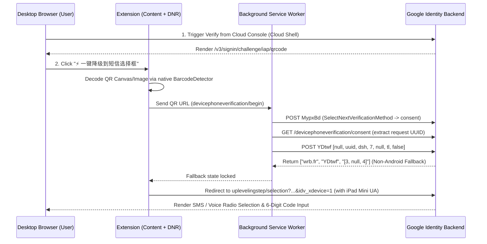

# Google QR SMS Helper (`google-qr-sms-helper`)

<p align="center">
  
  
  
  
</p>

<p align="center">
  <b>Chuyển quy trình xác minh quét mã QR liên thiết bị bắt buộc trên máy tính của Google (MO-SMS / GMS Constellation) về lại quy trình «nhập số điện thoại nhận mã xác minh SMS 6 chữ số» truyền thống chỉ với một cú nhấp chuột.</b><br/>
  Chuyển đổi xác minh QR liên thiết bị bắt buộc của Google về lại xác minh SMS / Thoại 6 chữ số tiêu chuẩn trên trình duyệt máy tính.
</p>

---

## 📦 1. Hướng dẫn cài đặt

### Cách 1: Tải trực tiếp gói nén Release (Khuyên dùng cho người mới)
1. Truy cập **[trang Releases](https://github.com/havenicec/google-qr-sms-helper/releases/latest)** của kho lưu trữ này, tải về tệp `google-qr-sms-helper-v1.1.0.zip` mới nhất và giải nén vào thư mục trên máy.
2. Mở trình duyệt Chrome / Edge / Brave, nhập `chrome://extensions/` vào thanh địa chỉ và nhấn Enter.
3. Bật công tắc **«Chế độ dành cho nhà phát triển (Developer mode)»** ở góc trên bên phải trang.
4. Nhấp vào nút **«Tải tiện ích đã giải nén (Load unpacked)»** ở góc trên bên trái, sau đó chọn thư mục vừa giải nén để hoàn tất cài đặt.

### Cách 2: Cài đặt qua Git clone
```bash
git clone https://github.com/havenicec/google-qr-sms-helper.git
```
Sau đó bật «Chế độ dành cho nhà phát triển» trong `chrome://extensions/`, nhấp «Tải tiện ích đã giải nén» và chọn thư mục `google-qr-sms-helper`.

---

## 🚀 2. Hướng dẫn sử dụng chi tiết từng bước

> [!IMPORTANT]
> **Điều kiện tiên quyết (Bắt buộc đọc)**: **Không** thực hiện hạ cấp trực tiếp từ trang mã QR bật lên từ ứng dụng bên thứ ba (như trang ủy quyền Antigravity / Gemini Code Assist), vì tham số `continue` của chúng chứa nhiều lớp chuyển hướng lồng nhau và sẽ bị Google chặn quay lại trang mã QR.  
> **Bắt buộc phải mở Google Cloud Console trước và gọi cửa sổ `Verify` gốc thông qua Cloud Shell**! Sau khi hoàn tất xác minh SMS một lần tại đây, quyền tài khoản Google của bạn sẽ được mở khóa trên toàn hệ thống; lúc này quay lại đăng nhập vào các công cụ như Antigravity sẽ thông qua mượt mà ngay lập tức.

### Bước 1: Mở Google Cloud Console và gọi xác minh Cloud Shell
1. Đăng nhập tài khoản Google cần xác minh trên trình duyệt và truy cập **[https://console.cloud.google.com/](https://console.cloud.google.com/)**.
2. Như minh họa bên dưới, nhấp vào biểu tượng terminal **«Kích hoạt Cloud Shell» `[>_]`** trên thanh điều hướng góc trên bên phải (hoặc nhấp trực tiếp nút **`1. Tự động nhấp biểu tượng terminal Cloud Shell`** trong cửa sổ nổi của tiện ích ở góc dưới bên phải trang).
3. Trong cửa sổ `Verify your account` bật lên ở phía dưới, nhấp vào nút **`Verify`** màu xanh lam:


---

### Bước 2: Nhấp «Hạ cấp nhanh về hộp chọn SMS» trên trang mã QR
1. Sau khi nhấp `Verify`, trang xác minh mã QR của Google (`/v3/signin/challenge/iap/qrcode`) sẽ xuất hiện.
2. Đợi hình ảnh mã QR tải xong, nhấp vào nút **«⚡ Hạ cấp nhanh về hộp chọn SMS»** trên bảng điều khiển nổi của tiện ích ở góc dưới bên phải trang:
   - Tiện ích sẽ tự động gọi `BarcodeDetector` gốc của trình duyệt để nhận diện mã QR trên trang;
   - Tự động gửi các gói dữ liệu `MypxBd` và `YDtwf ([null, uuid, dsh, 7, null, tl, false])` tới Google ở chế độ nền, nhận về `[3, null, 4]` (trạng thái quay về xác minh SMS cho thiết bị không phải Android);
   - Tự động giả lập tiêu đề yêu cầu và môi trường của tab hiện tại thành **`iPad Mini`** (không cần nhấn F12 chuyển thiết bị thủ công), và chuyển hướng tới `uplevelingstep/selection?...&idv_xdevice=1`.

---

### Bước 3: Chọn «Tin nhắn văn bản (Text message)» và nhập số điện thoại nhận mã
1. Trang sẽ tự động chuyển vào **trang chọn phương thức xác minh (`/uplevelingstep/selection`)** có các nút chọn:
   - Chọn **Text message (SMS) / Tin nhắn văn bản** (hoặc cuộc gọi thoại), nhấn Tiếp theo.
2. Nhập số điện thoại nhận mã của bạn vào ô nhập số điện thoại (hỗ trợ số từ các nền tảng nhận mã hoặc SIM vật lý ở bất kỳ quốc gia/khu vực nào), nhấn gửi mã xác minh.
3. Sau khi nhận được mã xác minh 6 chữ số dạng `G-xxxxxx`, điền vào và nhấn **Next** để hoàn tất xác minh tài khoản!
4. Sau khi xác minh thành công, quay lại Cloud Shell hoặc Antigravity / Gemini CLI và làm mới trang để sử dụng bình thường.

---

## ❓ 3. Câu hỏi thường gặp & Lưu ý tránh lỗi

### Q1: Tại sao khi tôi vào trang mã QR từ liên kết khác và nhấn hạ cấp lại bị chuyển về trang mã QR?
- **Nguyên nhân**: Chỉ trang mã QR được gọi từ `https://console.cloud.google.com/` bằng cách nhấp **Cloud Shell `[>_]` -> `Verify`** ở góc trên bên phải mới có tham số `continue` sạch là `https://accounts.google.com/uplevelingstep/selection?TL=...&authuser=0&flowName=GlifWebSignIn&sarp=1&scc=1`. Vui lòng làm đúng theo «Bước 1» để vào từ lối vào Cloud Shell.

### Q2: Tại sao tiện ích mặc định giả lập thành `iPad Mini` mà không phải `iPad Pro` hay trình duyệt máy tính?
- **Nguyên nhân**: Giao diện `uplevelingstep/selection` của Google sẽ kiểm tra `User-Agent`:
  - Máy tính (Windows / macOS) cũng như `iPad Pro 13` trong Chrome F12 đều gửi UA cấp máy tính `Macintosh; Intel Mac OS X`; khi phát hiện môi trường máy tính, Google sẽ bỏ qua `idv_xdevice=1` và ép chuyển về mã QR.
  - Trong khi đó, `iPad Mini` gửi tiêu đề yêu cầu thuần di động `iPad; CPU OS 16_6 like Mac OS X ... Mobile/15E148`, và tại điểm cuối `/_/IdvUplevelingUi/data/batchexecute` khi gửi mã xác minh 6 chữ số bắt buộc phải giữ tiêu đề yêu cầu `iPad Mini` đồng nhất hoàn toàn từ đầu đến cuối (đã được tự động ghi đè toàn đường dẫn qua `declarativeNetRequest` từ phiên bản v1.1.0, không cần mở F12 thủ công).

### Q3: Phải làm sao nếu nhấn «Hạ cấp nhanh» báo lỗi “Không thể nhận diện mã QR trên trang hiện tại”?
- Vui lòng đảm bảo bạn đang sử dụng trình duyệt **Chrome / Edge 88+** (hỗ trợ giao diện `BarcodeDetector` gốc) và đợi hình mã QR màu đen trên trang hiển thị hoàn toàn trước khi nhấp nút.

---

## ✨ 4. Nguyên lý kỹ thuật & Luồng hoạt động



---

## 📁 5. Cấu trúc thư mục

```text
google-qr-sms-helper/
├── assets/
│   └── cloud-shell-verify.png  # Cloud Shell Verify 入口示意图
├── manifest.json               # Chrome Extension Manifest V3 配置文件
├── background.js               # DNR 全路径 iPad Mini 请求头伪装 + [3,null,4] RPC 注入
├── content.js                  # 悬浮控制面板 + BarcodeDetector 二维码识别 + URL 清洗跳转
├── ua_spoof.js                 # Main-world navigator 属性对齐
├── LICENSE                     # MIT 开源协议
└── README.md                   # 项目说明与图文教程
```

---

## 📄 Giấy phép

Phát hành theo [Giấy phép MIT](./LICENSE).
